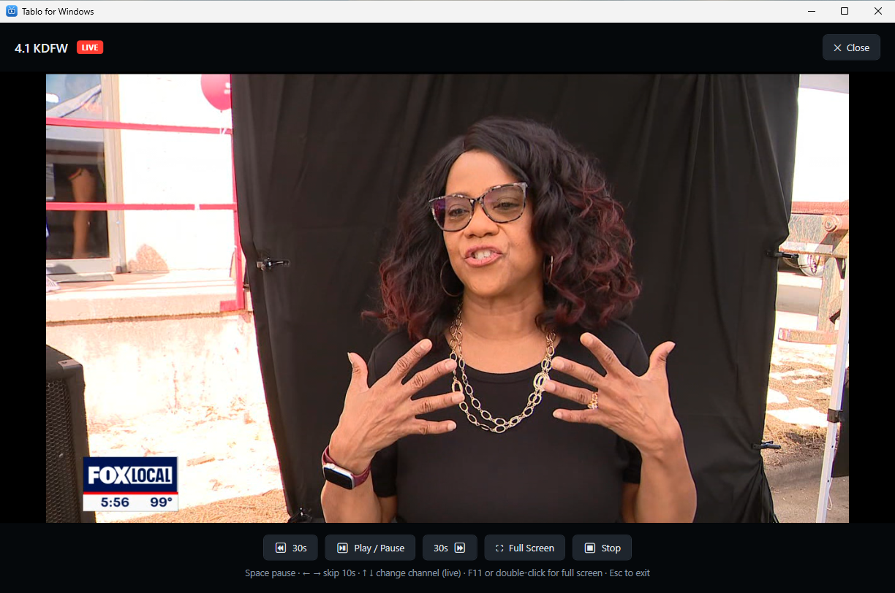
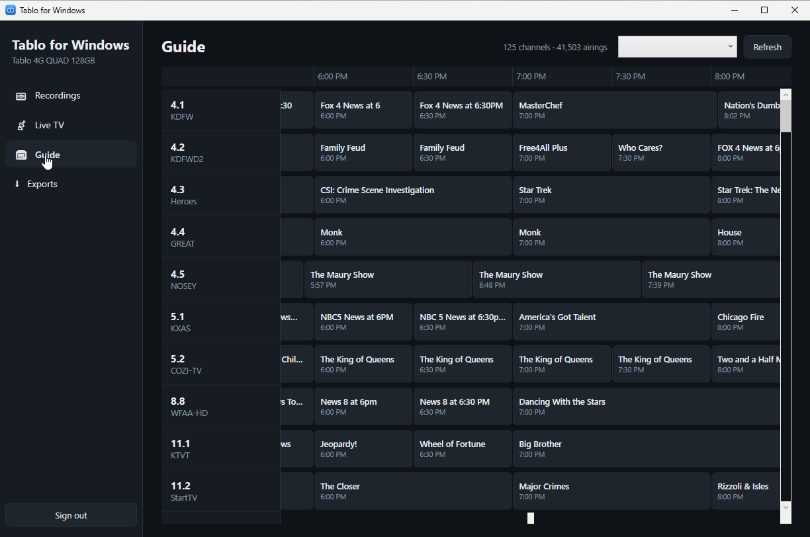
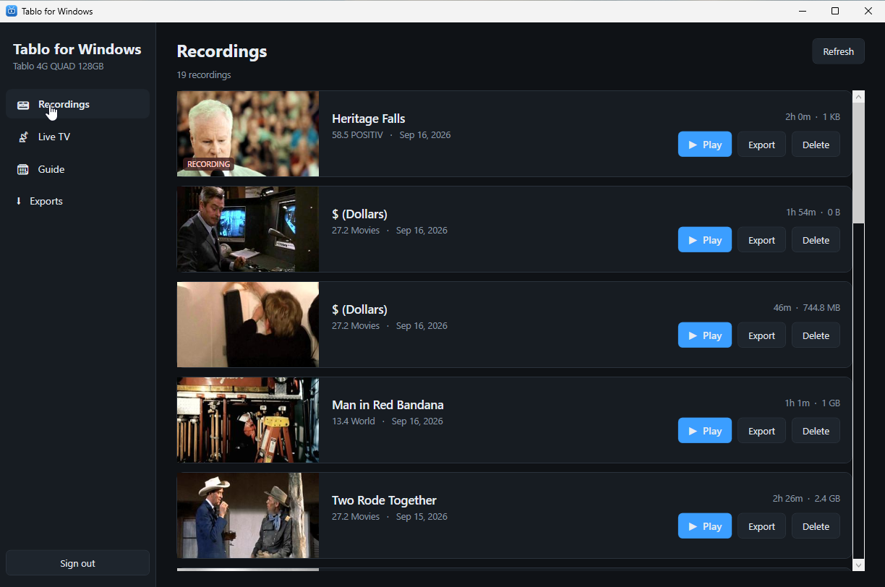

# Tablo for Windows

A Windows app for the **Tablo 4th-generation** over-the-air DVR: watch live TV, play and manage
recordings, browse the 14-day guide and schedule recordings from it — straight from your PC to the
DVR, with no server in between.

> **Note:** this only works on the 4th generation (Tablo 4G / QUAD, 2023 onward). Earlier
> generations use a different protocol.

> Unofficial. Not affiliated with, endorsed by, or supported by Tablo or Scripps. It talks to the
> DVR the same way the official apps do, using a protocol worked out by watching them.



## What it does

- **Live TV** — every antenna channel, plus the free streaming (FAST) channels on your account.
  - **Pause, rewind and fast-forward live TV.** Everything since you tuned the channel stays
    seekable; the heading shows how far behind live you are.
  - **Change channel with ↑ / ↓**, the way a TV remote does.
- **Recordings** — artwork, play, export and delete.
- **Guide** — a 14-day grid. Pick a programme to watch it now, or record the episode or the whole
  series.
- **Exports** — save a recording to a `.ts` file on your PC. It is a straight copy of the
  broadcast stream, not a re-encode, so it is fast and loses nothing.
- **Plays the broadcast as-is.** Tablo streams are MPEG-2 video with AC3 audio; the app decodes
  them itself with LibVLC (bundled — no VLC install needed), so nothing is transcoded.
- **Keeps itself up to date** from this repository's releases.

| Guide | Recordings |
|---|---|
|  |  |

## Install

Download the latest `TabloWindows-*.msi` from
**[Releases](https://github.com/ksaye/tablo-windows/releases)** and run it. Then start
*Tablo for Windows* from the Start menu and sign in with your Tablo account — the same email and
password the Tablo app uses.

When a newer release is published, the app offers to download and install it on startup.

## Keyboard

While something is playing:

| Key | Does |
|---|---|
| **Space** | Pause / resume |
| **← / →** | Skip back / forward 10 seconds (live TV too) |
| **↑ / ↓** | Next / previous channel (live TV). Waits a moment for more presses before tuning. |
| **Enter** | While changing channel: tune now. Otherwise pause / resume. |
| **F11** or double-click | Full screen |
| **Esc** | Leave full screen |

## Your account

The app signs in to Tablo's own cloud service, exactly as the official app does, and then talks
to the DVR on your local network. If you tick *Remember me on this PC*, your email and password
are stored encrypted with Windows DPAPI under your user profile
(`%AppData%\TabloWindows`) — readable only by your Windows account on this PC. **They are sent
nowhere except Tablo's login service.**

Sign out to forget them.

## A note on the DVR

The Tablo is inexpensive hardware. Loading the full guide is hundreds of requests and the
heaviest thing any app asks of it, so the guide is cached for 12 hours and only reloaded when you
press **Refresh**. Running several Tablo apps against one DVR at once can make it slow to answer
or refuse connections until it is power-cycled.

Every live channel and every recording being played uses one of the DVR's tuners until playback
stops.

## Building from source

Needs Windows, the [.NET 10 SDK](https://dotnet.microsoft.com/download) and, for the installer,
the WiX v5 tool (`dotnet tool install --global wix`).

```powershell
git clone https://github.com/ksaye/tablo-windows.git
cd tablo-windows
dotnet run --project src/TabloWindows

# the MSI
installer\build-msi.cmd
```

## Related

- **[tablo-web](https://github.com/ksaye/tablo-web)** — the same DVR in any browser, from a small
  server that transcodes for devices that cannot decode MPEG-2.
- **[tablo-firetv](https://github.com/ksaye/tablo-firetv)** — a Fire TV Stick app that talks to the
  DVR directly.

## License

MIT — see [LICENSE](LICENSE).
